# Álbum de fotos con NestJS

API desarrollada con NestJS y TypeScript para listar fotos, consultar una por ID, crear, actualizar y eliminar entradas.

**Autor** · Juan Diego Sotomayor

- [Taller 4 · CRUD con almacenamiento en memoria](#taller-4)
- [Taller 5 · Persistencia con PostgreSQL y TypeORM](#taller-5)

## Rutas de la API

La API está disponible en `http://localhost:3000/api/fotos`. El puerto predeterminado es 3000 y puede cambiarse con la variable de entorno `PORT`.

| Método | Ruta | Descripción | Respuesta exitosa |
| --- | --- | --- | --- |
| GET | `/api/fotos` | Listar fotos | 200, arreglo de fotos |
| GET | `/api/fotos/:id` | Consultar una foto por ID | 200, foto encontrada |
| POST | `/api/fotos` | Crear una foto | 201, foto creada |
| PATCH | `/api/fotos/:id` | Actualizar parcialmente una foto | 200, foto actualizada |
| DELETE | `/api/fotos/:id` | Eliminar una foto | 204, sin cuerpo |

Las rutas con `:id` usan `ParseIntPipe`: un ID no numérico devuelve 400. Si el ID es válido pero la foto no existe, GET, PATCH y DELETE devuelven 404 con el mensaje `Foto <id> no encontrada`.

## Taller 4

Los datos se guardan en memoria. Al reiniciar la aplicación se recuperan las dos fotos iniciales y se pierden los cambios realizados. [Documento de evidencias del Taller 4](docs/Taller%204%20-%202P%20-%20Juan%20Diego%20Sotomayor.pdf)

### Objetivo del reto

- Completar el CRUD con `update(id, datos)` y `remove(id)` en `FotosService`, y sus rutas PATCH y DELETE en el controlador.
- Responder `204 No Content` al eliminar mediante `@HttpCode(204)`.
- Reutilizar `findOne(id)` en actualización y eliminación para responder 404 cuando la foto no exista.
- Enviar un POST sin título y observar el resultado. La validación del cuerpo se deja para una sesión posterior, como indica el enunciado.

### Ejecución del Taller 4

Se necesita Node.js 24 y npm. Clona la rama `taller-4` para ejecutar la versión en memoria.

```bash
git clone --branch taller-4 https://github.com/jdsotomayorjimenez/taller4-2p-ddaw.git
cd taller4-2p-ddaw
npm ci
npm run start:dev
```

### Ejemplos en Postman

#### Crear una foto

Para `POST /api/fotos`, selecciona **Body → raw → JSON** y envía el siguiente cuerpo.

```json
{
  "titulo": "Cerro",
  "calificacion": 5
}
```

Si es la primera creación después de iniciar la aplicación, la nueva foto recibe el ID `3`. El servicio genera los IDs con un contador que avanza con cada creación, de modo que eliminar una foto no produce IDs duplicados.

#### Actualizar una foto

Envía `PATCH /api/fotos/1` con el siguiente cuerpo en **Body → raw → JSON**.

```json
{
  "calificacion": 5
}
```

La respuesta es 200 y contiene la foto Atardecer con calificación 5, conservando su título e ID. Solo se modifican los campos enviados.

#### Eliminar una foto

Envía `DELETE /api/fotos/1` sin cuerpo. La respuesta es `204 No Content`, sin JSON ni mensaje. Si repites la petición, devuelve 404 porque la foto ya no existe.

#### Probar un POST sin título

Envía este cuerpo a `POST /api/fotos`.

```json
{
  "calificacion": 7
}
```

La API responde 201 y guarda una entrada sin `titulo`. La interfaz `Foto` y los tipos de TypeScript no validan el JSON recibido durante la ejecución. En este taller se acepta el cuerpo de la petición sin validar el título ni restringir el rango de `calificacion`.

### Verificación

```bash
npm run build
npm run lint
```

Las pruebas manuales de las rutas están documentadas en las capturas siguientes. Los scripts `npm test` y `npm run test:e2e` están configurados, pero actualmente no hay archivos de pruebas automatizadas y terminan indicando `No test files found`.

### Capturas del Taller 4

Las capturas `0.png` a `5.png` documentan la implementación inicial. Las capturas `6.png` a `11.png` corresponden al reto del Taller 4 en una ejecución nueva. La entrada sin título recibe el ID `3` porque fue la primera foto creada en esa ejecución.

#### Generación del módulo, controlador y servicio


#### Listado de fotos — 200 OK

`GET /api/fotos` devuelve las fotos iniciales Atardecer y Malecón.


#### Foto inexistente — 404 Not Found

`GET /api/fotos/9` devuelve el mensaje `Foto 9 no encontrada`.


#### ID no numérico — 400 Bad Request

`GET /api/fotos/abc` es rechazado por `ParseIntPipe`.


#### Creación de una foto — 201 Created

`POST /api/fotos` crea la foto Cerro con ID `3`, partiendo de las dos fotos iniciales.


#### Listado después de la creación

La consulta posterior incluye la nueva foto.

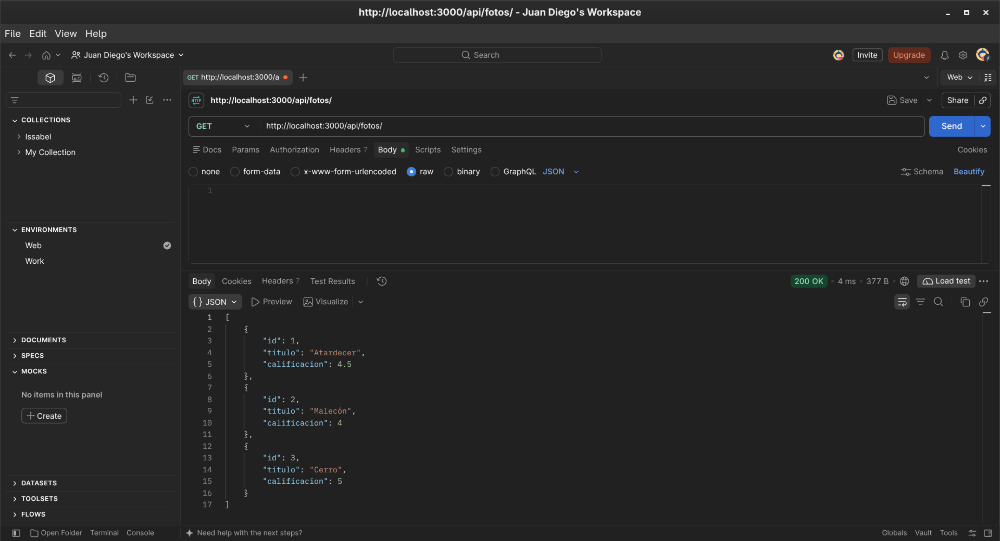

#### Actualización parcial — 200 OK

`PATCH /api/fotos/1` con `{"calificacion":5}` actualiza Atardecer y conserva su título e ID.


#### Actualización de una foto inexistente — 404 Not Found

`PATCH /api/fotos/9` devuelve `Foto 9 no encontrada` al reutilizar `findOne(id)`.

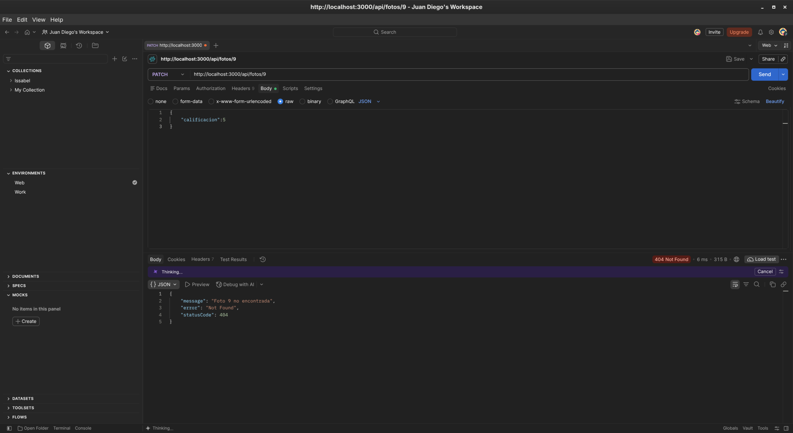

#### Eliminación — 204 No Content

`DELETE /api/fotos/1` elimina la foto. El decorador `@HttpCode(204)` establece el estado y la respuesta no contiene cuerpo.


#### Repetición de la eliminación — 404 Not Found

Al repetir `DELETE /api/fotos/1`, el servicio devuelve `Foto 1 no encontrada`.

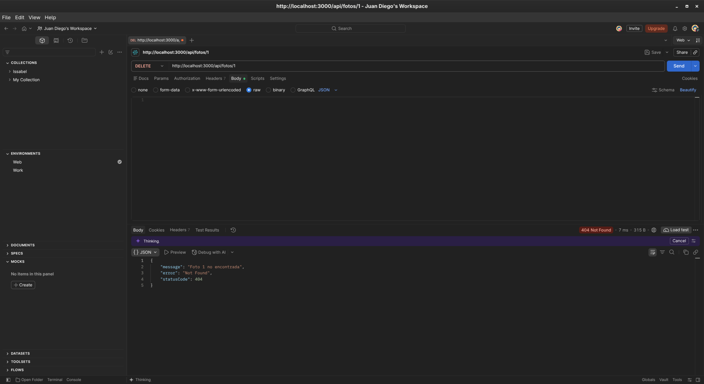

#### POST sin título — 201 Created

`POST /api/fotos` con `{"calificacion":7}` crea una entrada con ID `3` y sin `titulo`, mostrando la ausencia de validación del cuerpo en esta etapa.


#### Listado final del reto — 200 OK

`GET /api/fotos` muestra Malecón y la entrada sin título. Atardecer ya no aparece porque fue eliminada.


### Estructura

```text
src/
├── main.ts
├── app.module.ts
└── fotos/
    ├── fotos.module.ts
    ├── fotos.controller.ts
    ├── fotos.service.ts
    └── entities/
        └── foto.entity.ts
```

El controlador define las rutas, el servicio administra las fotos y el módulo registra ambos.

Las imágenes están en `capturas/taller-4/` y el documento de evidencias está en `docs/`.

## Taller 5

La API guarda las fotos en PostgreSQL mediante TypeORM. `Foto` se registra como la entidad de `public.fotos`. PostgreSQL genera el ID y asigna las fechas al insertar. El servicio valida el título y usa el repositorio para consultar y crear fotos, `save()` para actualizarlas y `remove()` para eliminarlas.

### Ejecución del Taller 5

Se necesita Node.js 24, npm y un servidor PostgreSQL local activo. Crea la base `album` si todavía no existe. Si aún no tienes un `.env`, copia la plantilla desde la raíz del proyecto. [Plantilla de configuración](.env.example)

```bash
cp .env.example .env
```

Configura `DB_USER` y `DB_PASSWORD` en `.env` con las credenciales de tu instalación. Luego instala las dependencias, carga las fotos de ejemplo y arranca la API.

```bash
npm ci
npm run seed
npm run start:dev
```

TypeORM sincroniza la tabla al iniciar el seed o la API. `npm run seed` carga 10 fotos cuando la tabla está vacía y omite la carga cuando ya hay registros. Para observar la tabla vacía como en la evidencia, inicia primero la API y consulta la tabla en pgAdmin. Luego detén NestJS, ejecuta el seed y vuelve a iniciar la API.

### Capturas del Taller 5

#### Arranque de NestJS y creación de la tabla

La terminal muestra el arranque de NestJS con TypeORM y el registro de las cinco rutas.

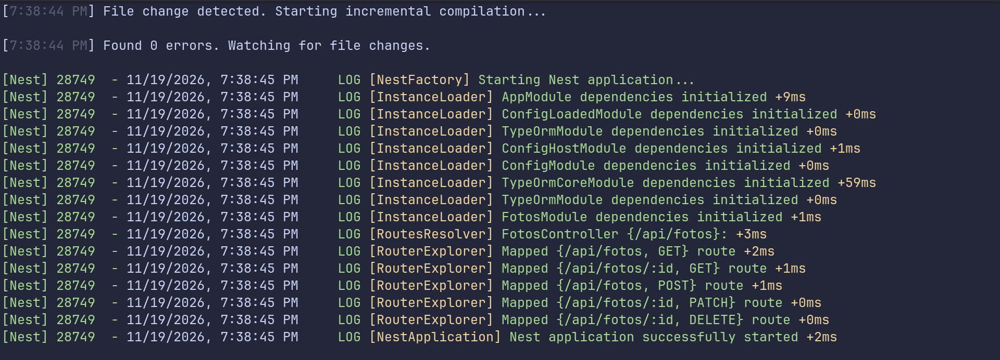

pgAdmin muestra `public.fotos` en la base `album` con sus columnas y cero filas antes de la carga.

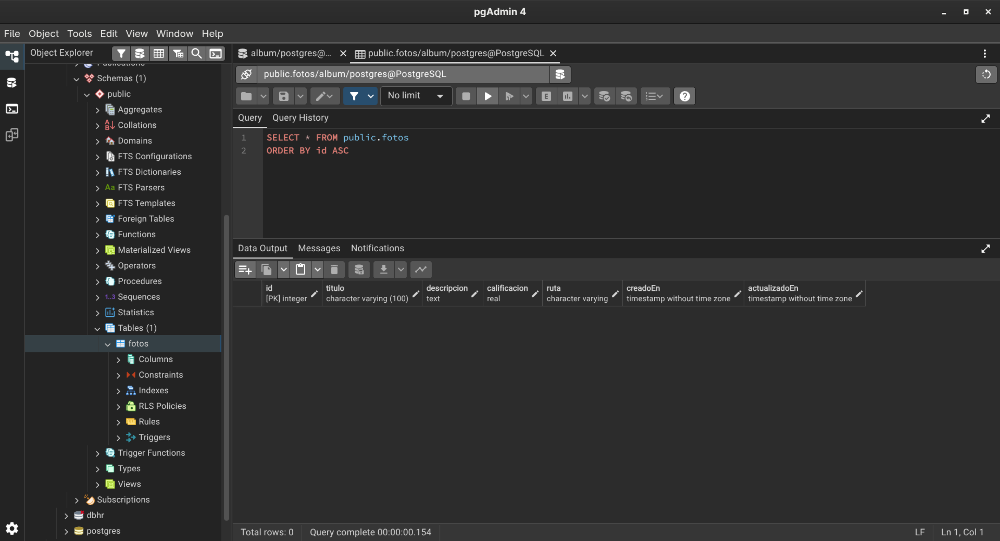

#### Carga de las 10 fotos de ejemplo

La terminal muestra el comando `npm run seed` y confirma las 10 inserciones.

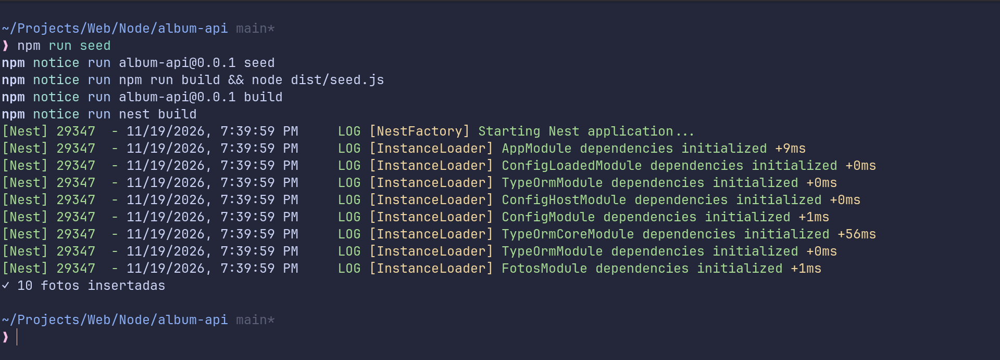

La consulta en pgAdmin muestra las 10 fotos guardadas, con IDs del 1 al 10 y las fechas generadas al insertar.

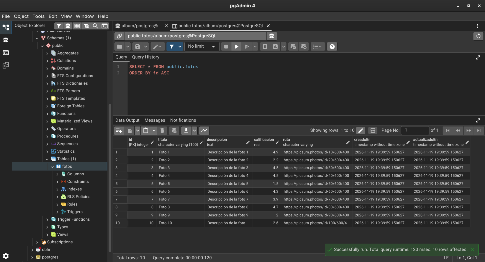

#### Consulta por ID, creación y persistencia

`GET /api/fotos/3` devuelve `200 OK`, el registro `Foto 3` y su calificación `4.5`.

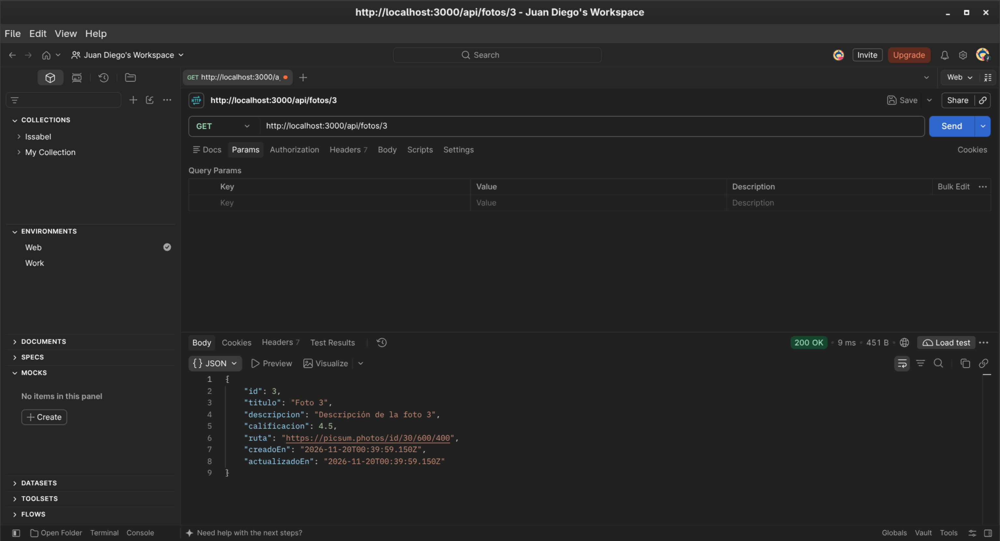

`POST /api/fotos` con `{"titulo":"Cerro","calificacion":5,"ruta":"x.jpg"}` devuelve `201 Created`. En esta ejecución, PostgreSQL asignó el ID `11`.

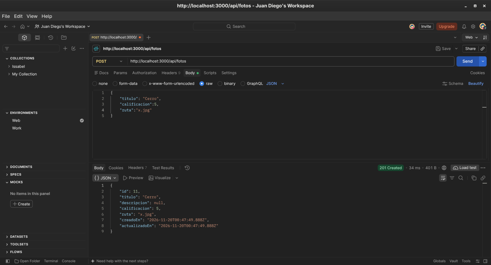

`GET /api/fotos` muestra a `Cerro` con el mismo ID y fecha de creación. Para reproducir la prueba de persistencia, reinicia NestJS y vuelve a consultar el listado o el ID que devolvió el POST.

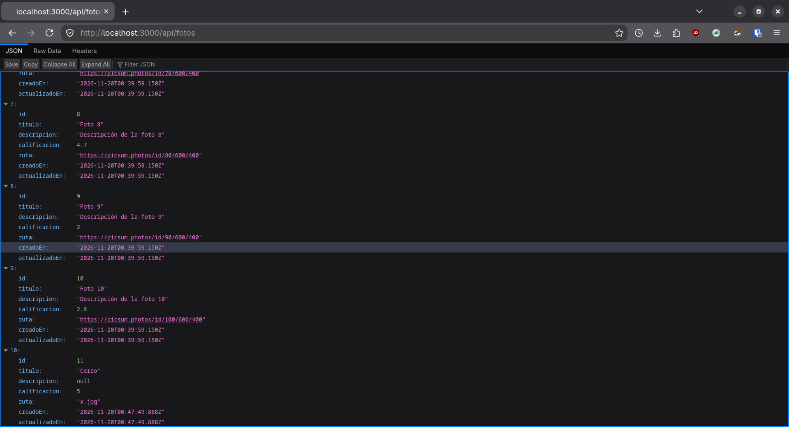

#### Columna opcional y renombrado de `autor` a `fotografo`

Para el reto se agregó `autor` a `Foto` con `@Column({ type: 'text', nullable: true })`. Tras sincronizar la tabla, se asignó `Juan Diego` a `Cerro` (ID `11`) desde pgAdmin.


Luego se cambió el nombre de la propiedad a `fotografo`, conservando el tipo `text` y la opción `nullable`. Después del arranque se consultó la misma fila. **El valor `Juan Diego` se conservó** en la columna `fotografo`.

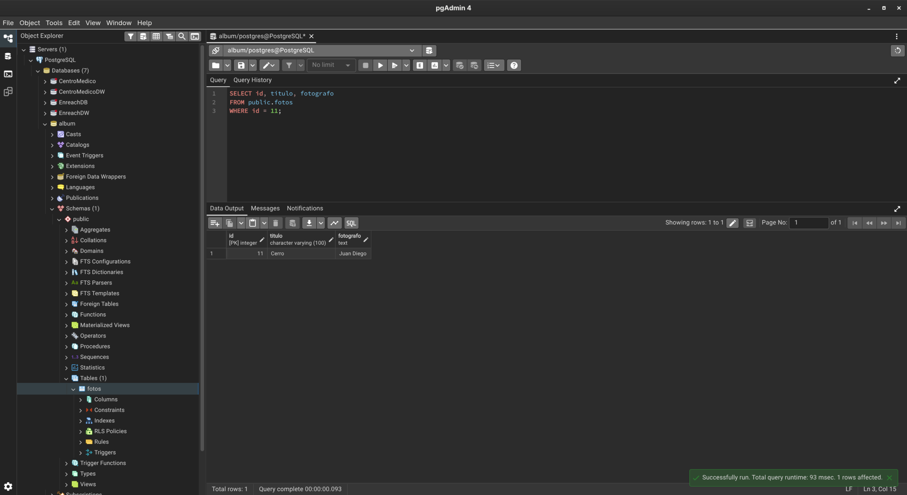

`synchronize: true` modifica el esquema al arrancar. En este ejercicio conservó el valor, pero otros cambios de esquema pueden eliminar datos. En producción, una migración permite revisar el cambio de antemano y registrar qué se aplicó, por ejemplo un `ALTER TABLE ... RENAME COLUMN ...` explícito. [Migraciones en TypeORM](https://typeorm.io/docs/migrations/why/)

#### Actualización parcial y eliminación con el repositorio

`PATCH /api/fotos/11` con `{"calificacion":4.5}` devuelve `200 OK`. El servicio busca `Cerro`, aplica el cambio y guarda la entidad con `save()`. La respuesta conserva el ID y `fotografo: "Juan Diego"` y muestra la nueva calificación.

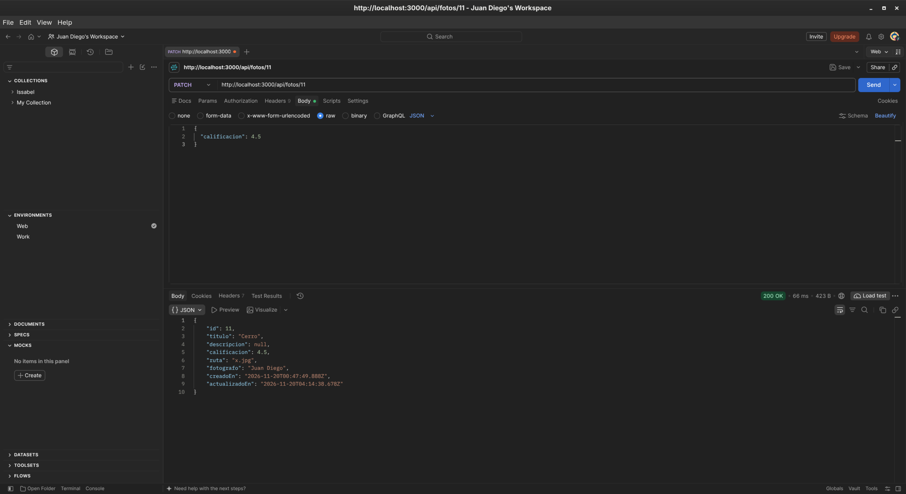

Para probar la eliminación, `POST /api/fotos` creó `Foto temporal` con ID `12` y devolvió `201 Created`.

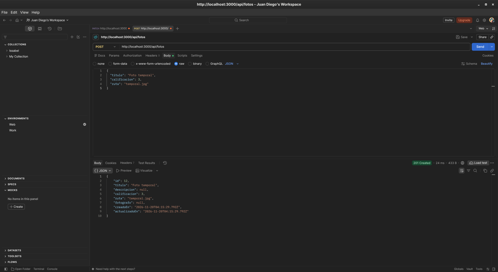

`DELETE /api/fotos/12` busca la entidad y la elimina con `remove()`. Postman muestra `204 No Content` con el cuerpo vacío.

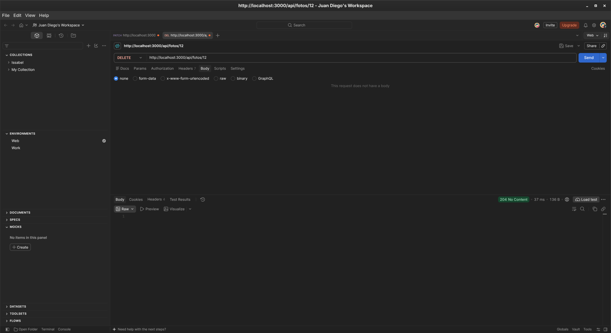
