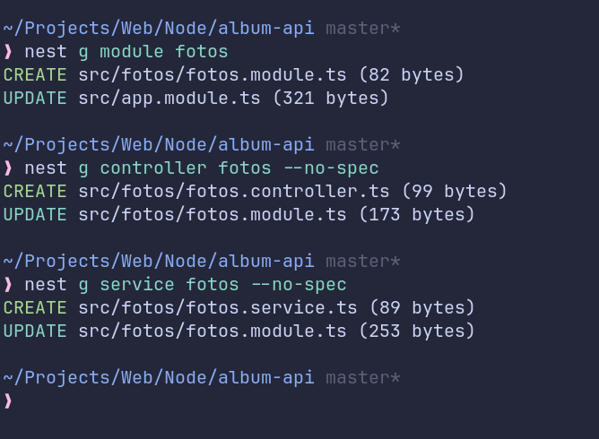
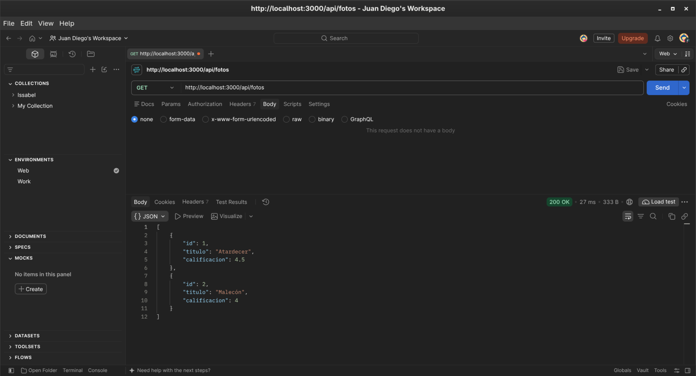
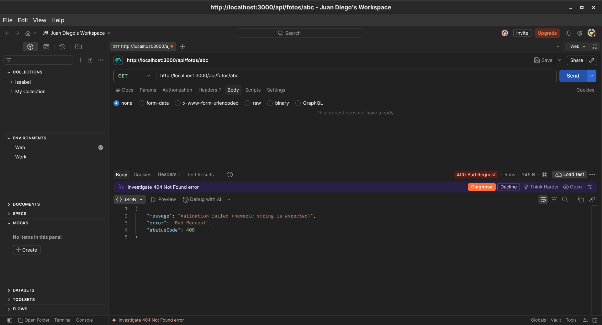
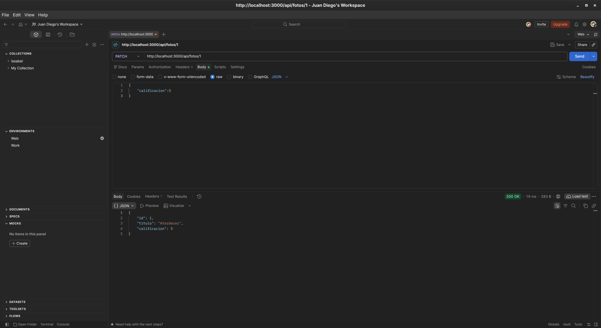
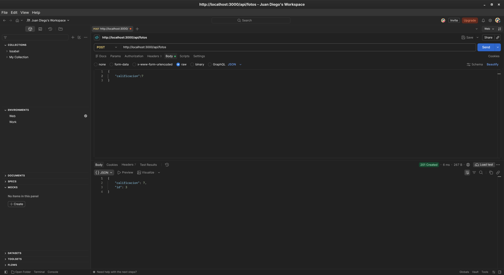
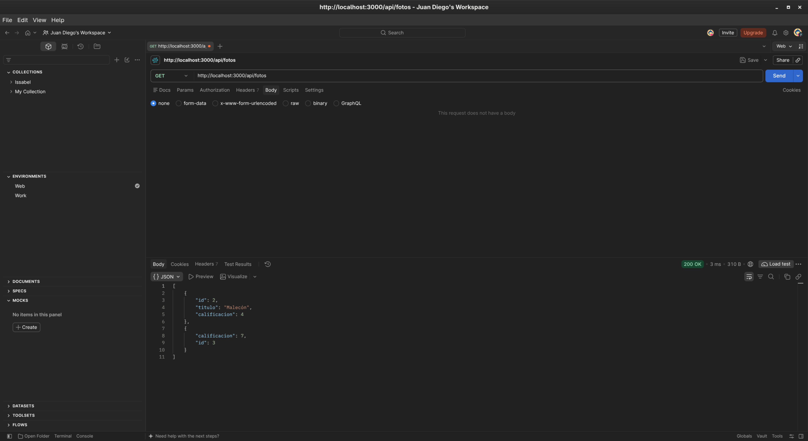

# Taller #4 · CRUD de álbum de fotos con NestJS

API desarrollada con NestJS y TypeScript para listar fotos, consultar una por ID, crear, actualizar y eliminar entradas. Los datos se guardan en memoria: al reiniciar la aplicación se recuperan las dos fotos iniciales y se pierden los cambios realizados.

- **Autor:** Juan Diego Sotomayor.
- **Repositorio:** [jdsotomayorjimenez/taller4-2p-ddaw](https://github.com/jdsotomayorjimenez/taller4-2p-ddaw).
- **Documento de evidencias:** [Taller 4 - 2P - Juan Diego Sotomayor.pdf](docs/Taller%204%20-%202P%20-%20Juan%20Diego%20Sotomayor.pdf).

## Objetivo del reto

- Completar el CRUD con `update(id, datos)` y `remove(id)` en `FotosService`, y sus rutas PATCH y DELETE en el controlador.
- Responder `204 No Content` al eliminar mediante `@HttpCode(204)`.
- Reutilizar `findOne(id)` en actualización y eliminación para responder 404 cuando la foto no exista.
- Enviar un POST sin título y observar el resultado. La validación del cuerpo se deja para una sesión posterior, como indica el enunciado.

## Ejecución

Se necesita Node.js 24 y npm.

```bash
git clone https://github.com/jdsotomayorjimenez/taller4-2p-ddaw.git
cd taller4-2p-ddaw
npm ci
npm run start:dev
```

La API está disponible en `http://localhost:3000/api/fotos`. El puerto predeterminado es 3000 y puede cambiarse con la variable de entorno `PORT`.

## Rutas

| Método | Ruta | Descripción | Respuesta exitosa |
| --- | --- | --- | --- |
| GET | `/api/fotos` | Listar fotos | 200, arreglo de fotos |
| GET | `/api/fotos/:id` | Consultar una foto por ID | 200, foto encontrada |
| POST | `/api/fotos` | Crear una foto | 201, foto creada |
| PATCH | `/api/fotos/:id` | Actualizar parcialmente una foto | 200, foto actualizada |
| DELETE | `/api/fotos/:id` | Eliminar una foto | 204, sin cuerpo |

Las rutas con `:id` usan `ParseIntPipe`: un ID no numérico devuelve 400. Si el ID es válido pero la foto no existe, GET, PATCH y DELETE devuelven 404 con el mensaje `Foto <id> no encontrada`.

## Ejemplos en Postman

### Crear una foto

Para `POST /api/fotos`, selecciona **Body → raw → JSON** y envía:

```json
{
  "titulo": "Cerro",
  "calificacion": 5
}
```

Si es la primera creación después de iniciar la aplicación, la nueva foto recibe el ID `3`. El servicio genera los IDs con un contador que avanza con cada creación, de modo que eliminar una foto no produce IDs duplicados.

### Actualizar una foto

Envía `PATCH /api/fotos/1` con **Body → raw → JSON**:

```json
{
  "calificacion": 5
}
```

La respuesta es 200 y contiene la foto Atardecer con calificación 5, conservando su título e ID. Solo se modifican los campos enviados.

### Eliminar una foto

Envía `DELETE /api/fotos/1` sin cuerpo. La respuesta es `204 No Content`, sin JSON ni mensaje. Si repites la petición, devuelve 404 porque la foto ya no existe.

### Probar un POST sin título

Envía `POST /api/fotos` con:

```json
{
  "calificacion": 7
}
```

La API responde 201 y guarda una entrada sin `titulo`. La interfaz `Foto` y los tipos de TypeScript no validan el JSON recibido durante la ejecución. En este taller no se valida el cuerpo ni se restringe el rango de `calificacion`; esta petición documenta el comportamiento pedido por el reto.

## Verificación

```bash
npm run build
npm run lint
```

Las pruebas manuales de las rutas están documentadas en las capturas siguientes. Los scripts `npm test` y `npm run test:e2e` están configurados, pero actualmente no hay archivos de pruebas automatizadas y terminan indicando `No test files found`.

## Capturas

Las capturas `0.png` a `5.png` documentan la implementación inicial. Las capturas `6.png` a `11.png` corresponden al reto del Taller 4 en una ejecución nueva, sin crear previamente la foto Cerro; por eso la entrada sin título recibe el ID `3`.

### Generación del módulo, controlador y servicio



### Listado de fotos — 200 OK

`GET /api/fotos` devuelve las fotos iniciales Atardecer y Malecón.



### Foto inexistente — 404 Not Found

`GET /api/fotos/9` devuelve el mensaje `Foto 9 no encontrada`.


### ID no numérico — 400 Bad Request

`GET /api/fotos/abc` es rechazado por `ParseIntPipe`.



### Creación de una foto — 201 Created

`POST /api/fotos` crea la foto Cerro con ID `3`, partiendo de las dos fotos iniciales.


### Listado después de la creación

La consulta posterior incluye la nueva foto.


### Actualización parcial — 200 OK

`PATCH /api/fotos/1` con `{"calificacion":5}` actualiza Atardecer y conserva su título e ID.



### Actualización de una foto inexistente — 404 Not Found

`PATCH /api/fotos/9` devuelve `Foto 9 no encontrada` al reutilizar `findOne(id)`.


### Eliminación — 204 No Content

`DELETE /api/fotos/1` elimina la foto. El decorador `@HttpCode(204)` establece el estado y la respuesta no contiene cuerpo.


### Repetición de la eliminación — 404 Not Found

Al repetir `DELETE /api/fotos/1`, el servicio devuelve `Foto 1 no encontrada`.


### POST sin título — 201 Created

`POST /api/fotos` con `{"calificacion":7}` crea una entrada con ID `3` y sin `titulo`, mostrando la ausencia de validación del cuerpo en esta etapa.



### Listado final del reto — 200 OK

`GET /api/fotos` muestra Malecón y la entrada sin título. Atardecer ya no aparece porque fue eliminada.



## Estructura

```text
src/
├── main.ts
├── app.module.ts
└── fotos/
    ├── fotos.module.ts
    ├── fotos.controller.ts
    ├── fotos.service.ts
    └── entities/
        └── foto.entity.ts
```

El controlador define las rutas, el servicio administra las fotos y el módulo registra ambos.

Las imágenes están en `capturas/` y el documento de evidencias está en `docs/`.
