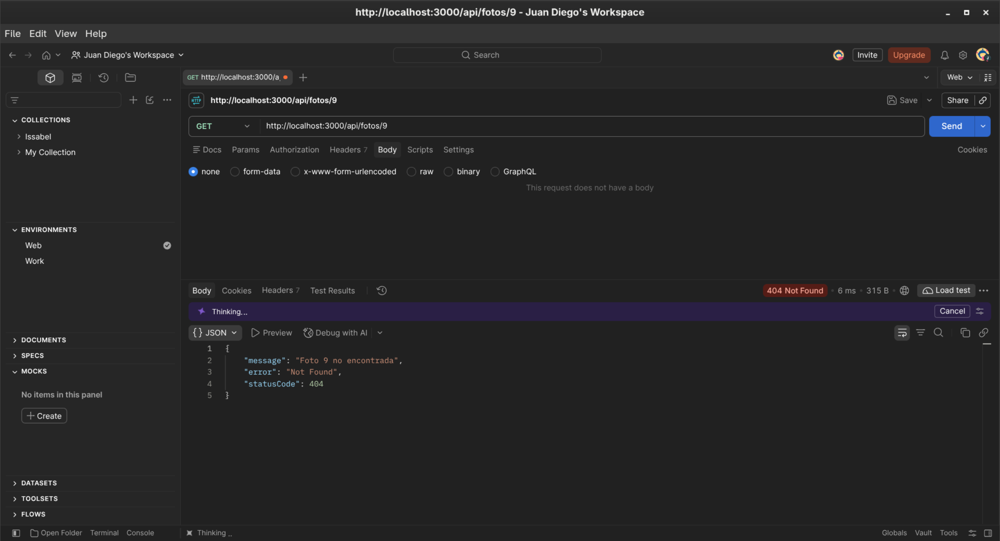
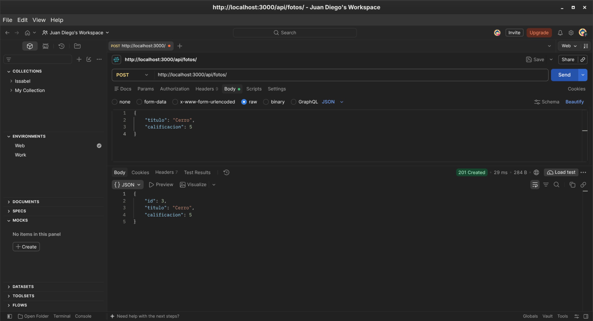

# Taller #3 · Álbum de fotos con NestJS

API de un álbum de fotos desarrollada con NestJS y TypeScript. Permite listar las fotos, consultar una por ID y crear nuevas entradas. Los datos se guardan en memoria.

> **Objetivo:** organizar la API en módulos, controladores y servicios de NestJS, utilizar inyección de dependencias y comprobar las respuestas HTTP de consulta, creación y manejo de errores.

## Requisitos y ejecución

Se necesita Node.js compatible con las dependencias del proyecto (por ejemplo, Node.js 24) y npm. Para reproducir las pruebas se utiliza Postman; las consultas GET también pueden realizarse desde el navegador.

Desde la carpeta del proyecto:

```bash
npm ci
npm run start:dev
```

La API escucha en [http://localhost:3000](http://localhost:3000) por defecto. El puerto puede cambiarse mediante la variable de entorno `PORT`. Todas las rutas tienen el prefijo `/api`; la ruta raíz `/` no tiene un controlador y responde `404`.

Para compilar y ejecutar la versión compilada:

```bash
npm run build
node dist/main.js
```

## Pruebas y capturas

### Generación del módulo de fotos

La estructura del recurso se generó con Nest CLI, separando el módulo, el controlador y el servicio:

```bash
nest g module fotos
nest g controller fotos --no-spec
nest g service fotos --no-spec
```

Estos comandos documentan la creación inicial; no es necesario repetirlos para ejecutar el proyecto.


### Postman

Usa `http://localhost:3000` como base de las URL. Para el `POST`, selecciona **Body → raw → JSON**. Las consultas GET no necesitan cuerpo.

Las pruebas parten de las fotos con ID `1` y `2`. Ejecuta el POST una sola vez después de iniciar el servidor para obtener la foto Cerro con ID `3`. Las creaciones posteriores reciben otros IDs según la cantidad de fotos en memoria.

| Método y ruta | Cuerpo JSON | Estado esperado |
| --- | --- | --- |
| `GET /api/fotos` | — | `200 OK`, con las dos fotos iniciales |
| `GET /api/fotos/9` | — | `404 Not Found`, con el mensaje `Foto 9 no encontrada` |
| `GET /api/fotos/abc` | — | `400 Bad Request`, por un ID no numérico |
| `POST /api/fotos` | `{"titulo":"Cerro","calificacion":5}` | `201 Created`, con la foto creada y el ID `3` |
| `GET /api/fotos` después del POST | — | `200 OK`, con la foto Cerro incluida |

#### Consulta de fotos

La consulta de la lista devuelve las fotos Atardecer y Malecón, con sus calificaciones, y el estado `200`.


#### Foto inexistente

La consulta de la foto `9` responde `404`. El servicio lanza `NotFoundException` y NestJS devuelve el mensaje junto con `error` y `statusCode`.

```json
{
  "message": "Foto 9 no encontrada",
  "error": "Not Found",
  "statusCode": 404
}
```



#### Validación del ID

La consulta con el ID `abc` responde `400`. `ParseIntPipe` rechaza el parámetro antes de ejecutar la búsqueda en el servicio.

```json
{
  "message": "Validation failed (numeric string is expected)",
  "error": "Bad Request",
  "statusCode": 400
}
```


#### Creación de fotos

El POST con `{"titulo":"Cerro","calificacion":5}` crea la foto y responde `201`. Con las dos fotos iniciales, la respuesta es:

```json
{
  "id": 3,
  "titulo": "Cerro",
  "calificacion": 5
}
```



La consulta posterior confirma que la nueva foto aparece en el arreglo junto con Atardecer y Malecón.


### Comprobación de los casos del taller

Los cuatro casos de la diapositiva se verificaron contra la aplicación: listado `200`, foto inexistente `404`, ID no numérico `400` y creación de Cerro `201`. También se comprobó que una consulta posterior devuelve la foto creada. La compilación de TypeScript finalizó sin errores.

Esta comprobación se realizó con una ejecución temporal; el repositorio todavía no contiene archivos de pruebas automatizadas, aunque incluye la configuración de Vitest.

## Funcionamiento y estructura actual

`main.ts` crea la aplicación, configura el prefijo global `/api` y abre el puerto. `AppModule` importa `FotosModule`, que registra `FotosController` y `FotosService`.

- **Controlador:** define las rutas con `@Controller('fotos')`, `@Get()` y `@Post()`. Recibe el cuerpo JSON con `@Body()` y convierte el ID mediante `@Param('id', ParseIntPipe)`.
- **Servicio:** mantiene el arreglo de fotos. Devuelve la lista, busca una foto con `find` y lanza `NotFoundException` cuando no existe. La creación asigna un ID con `fotos.length + 1` y agrega la foto con `push`.
- **Inyección de dependencias:** NestJS proporciona `FotosService` al constructor de `FotosController`, a partir de su registro en el módulo.
- **Modelo:** la interfaz `Foto` define `id`, `titulo`, `calificacion` y el campo opcional `descripcion`.

```text
src/
├── main.ts                     Inicio, prefijo /api y puerto
├── app.module.ts               Módulo principal
└── fotos/
    ├── fotos.module.ts         Registro del controlador y servicio
    ├── fotos.controller.ts     Rutas GET y POST
    ├── fotos.service.ts        Datos y operaciones en memoria
    └── entities/
        └── foto.entity.ts      Interfaz Foto
capturas/                       Evidencias del taller
package.json                    Dependencias y comandos
package-lock.json               Versiones resueltas de las dependencias
nest-cli.json                   Configuración de Nest CLI
tsconfig.json                   Configuración de TypeScript y ESM
tsconfig.build.json             Configuración de compilación
vitest.config.ts                Configuración de pruebas unitarias
vitest.config.e2e.ts            Configuración de pruebas e2e
README.md                       Documentación del taller
```

El proyecto utiliza ESM y mantiene la extensión `.js` en los imports relativos de los archivos TypeScript.

La validación actual comprueba el ID de la ruta mediante `ParseIntPipe`. El tipo `Omit<Foto, 'id'>` describe el cuerpo del POST para TypeScript, pero no valida sus campos durante la ejecución. No se han implementado rutas PATCH o DELETE ni almacenamiento en base de datos.

## ¿Qué ocurre al reiniciar el servidor?

Las fotos se almacenan en el arreglo `fotos`, dentro de la memoria del servicio. Al detener el servidor con `Ctrl+C` y volver a ejecutar `npm run start:dev`, vuelven las fotos Atardecer y Malecón con sus valores originales.

Por eso desaparecen las fotos creadas y la próxima creación vuelve a recibir el ID `3`. Se puede comprobar repitiendo `GET /api/fotos` antes y después del reinicio.

Como el comando de desarrollo utiliza el modo de observación, guardar cambios en el código también puede reiniciar la aplicación y restablecer el arreglo. Para conservar los datos entre reinicios se necesitaría almacenamiento persistente.
